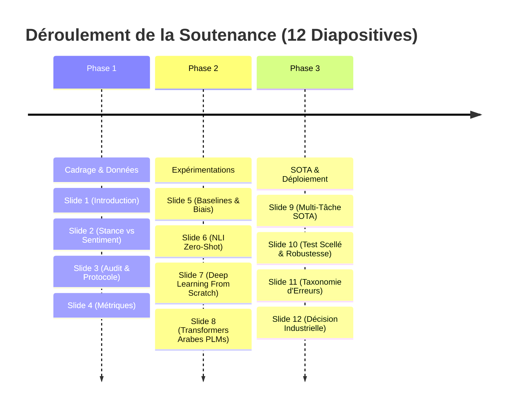

# 🖥️ Support de Présentation : Soutenance de Projet M2
# Détection de Position (*Stance Detection*) en Arabe sur Twitter (Corpus Mawqif)

**Auteurs :** Abdelhamid Rherib & [Nom du Binôme]  
**Formation :** Master 2 TALN (Traitement Automatique du Langage Naturel)  
**Format :** 12 Slides Projetées – Temps estimé : 15 à 20 minutes  

---

## 📌 Structure Globale de la Présentation



---

## 🎞️ Diapositive 1 : Titre & Introduction Générale
### *Stance Detection en Langue Arabe : Du Trivial au SOTA Multi-Tâche*

* **Contexte :** Projet de recherche Master 2 TALN & LLM appliqué aux micromessages Twitter.
* **Corpus d'Étude :** Dataset **Mawqif** (Alturayeif et al., SemEval / StanceEval 2024).
  * $3\,502$ tweets d'entraînement et $619$ tweets de test scellé.
  * 3 cibles sociétales : **Covid Vaccine**, **Digital Transformation**, **Women empowerment**.
* **Objectif Clé :** Déterminer la position idéologique de l'auteur (`Favor`, `Against`, `None`) face à une cible donnée, en surmontant les défis morphologiques de l'arabe et le bruit dialectal.
* **Résultat Majeur :** Nouveau record de performance établi à **$F_1 = 0.8536$** via une architecture Transformer multi-tâche.

---

## 🎞️ Diapositive 2 : La Problématique Fondamentale : Position $\neq$ Sentiment
### *Pourquoi classer le sentiment échoue à comprendre l'opinion idéologique*

* **L'Intuition Trompeuse :** "Si un tweet est positif, l'auteur est Pour ; s'il est négatif, l'auteur est Contre."
* **La Réalité Empirique :**
  * Un modèle de sentiment parfait (Oracle annotateurs) plafonne à **$F_1 = 0.7481$** !
  * **$25\%$ des tweets** présentent un sentiment opposé à leur position.
* **Exemple Concret (Tweet Réel du Corpus) :**
  > « هؤلاء المتخلفين الذين يرفضون اللقاح هم سبب استمرار هذه الجائحة اللعينة! تطعموا فوراً. »  
  > *(Ces arriérés qui refusent le vaccin sont la cause de cette maudite pandémie ! Faites-vous vacciner.)*
  * **Sentiment :** *Très Négatif* (colère, insulte, lexique péjoratif).
  * **Position (Stance) :** **FAVOR** (défense absolue de la vaccination).
* **Conclusion :** La détection de position exige d'identifier l'**entité cible** du jugement, au-delà de la charge affective du texte.

---

## 🎞️ Diapositive 3 : Audit des Données & Rigueur Méthodologique
### *Prévention du Data Leakage & Découpage Stratifié*

* **Correction d'Artefact Critique :**
  * Pandas interprétait par défaut le libellé `"None"` comme une valeur manquante `NaN` (333 tweets perdus).
  * Corrigé via `keep_default_na=False`.
* **Résolution des Doublons Antagonistes :**
  * Détection d'un tweet identique annoté à la fois `Favor` et `Against` sur la transformation digitale. Résolution par vote de confiance des annotateurs (`Favor` conservé).
* **Découpage Stratifié 10% :**
  * Découpage selon l'interaction $\text{Target} \times \text{Stance}$ pour préserver fidèlement les sous-classes :
    * Train interne : $3\,151$ tweets ($90\%$)
    * Validation interne : $351$ tweets ($10\%$)
* **La Règle d'Or du Test Scellé :**
  * Le test officiel de $619$ tweets a été **scellé jusqu'à la fin absolue du projet** pour interdire toute fuite d'information (*Data Leakage*).

---

## 🎞️ Diapositive 4 : Les Métriques d'Évaluation : Pourquoi pas l'Accuracy ?
### *Équité et Sanction du Déséquilibre de Classes*

* **Déséquilibre Observé :** `Favor` ($61.3\%$), `Against` ($29.1\%$), `None` ($9.6\%$).
* **L'Échec de l'Accuracy :**
  * Un classifieur naïf "Toujours Favor" obtient une Accuracy trompeuse de **$61.25\%$** sans rien apprendre !
* **Macro-$F_1$ (3 classes) :**
  $$\text{Macro-}F_1 = \frac{F_{1,\text{Favor}} + F_{1,\text{Against}} + F_{1,\text{None}}}{3}$$
  * Force le modèle à reconnaître la classe minoritaire `None` ($<10\%$).
* **Métrique Officielle StanceEval :**
  $$F_{1,\text{StanceEval}} = \frac{F_{1,\text{Favor}} + F_{1,\text{Against}}}{2}$$
  * Évalue la capacité décisionnelle à arbitrer les camps opposés (*Pour* vs *Contre*).

---

## 🎞️ Diapositive 5 : Partie A : Baselines & Raccourcis Superficiels
### *Quand le modèle apprend des artefacts plutôt que du sens*

* **Heuristique Cible $\to$ Majorité :** Prédire systématiquement la majorité de chaque cible donne $F_1 = \mathbf{0.3804}$.
* **Heuristique par Hashtags de Soutien :** 72 hashtags explicites mènent à $F_1 = \mathbf{0.4071}$.
* **Le Modèle Linéaire TF-IDF (Mots 1-2 + Caractères 2-5) :**
  * Atteint un très solide **$F_1 = 0.7278$** avec optimisation de seuils.
  * **Ablation :** Retirer les n-grammes de caractères fait chuter le score de $4$ points (l'arabe est une langue agglutinante à morphologie riche).
  * **La Faille :** Le TF-IDF mémorise des mots de surface (ex: « مؤامرة » $\to$ Contre) mais est aveugle à la réfutation syntaxique.

---

## 🎞️ Diapositive 6 : Partie B : Inférence NLI Zero-Shot Multilingue
### *Classifier sans entraînement grâce aux paires Prémisse-Hypothèse*

* **Architecture :** `mDeBERTa-v3-base-xnli` (2,7 millions de paires d'entraînement).
* **Formatage Logique :**
  * Prémisse : Le Tweet en Arabe.
  * Hypothèse : Formulation explicite en Arabe, Anglais ou Français.
* **Le Verdict des Langues :**
  * Hypothèses en **Arabe natif :** **$F_1 = \mathbf{0.6925}$** ($\theta = 0.30$)
  * Hypothèses en **Anglais :** $F_1 = 0.5693$ (chute de **$-12.3$ pts**)
  * Hypothèses en **Français :** $F_1 = 0.5471$ (chute de **$-14.5$ pts**)
* **Enseignement :** Le cross-linguisme pénalise fortement l'attention croisée. Formuler les hypothèses dans la langue source est capital.

---

## 🎞️ Diapositive 7 : Partie C : Deep Learning "From Scratch"
### *BiLSTM, Attention Additive, Transformer et le Sacre du Char-CNN*

* **Contrainte Majeure :** Vocabulaire de mots = $8\,152$ termes $\implies$ **Taux OOV de $20.2\%$** sur Val et Test !

| Modèle From Scratch | $F_{1,\text{StanceEval}}$ | Macro-$F_1$ | Particularité & Découverte |
| :--- | :---: | :---: | :--- |
| **C1 : BiLSTM Standard** | $0.7177$ | $0.4785$ | Séquentiel bidirectionnel |
| **C2 : BiLSTM + Attention (Bahdanau)** | $0.7048$ | $0.4699$ | L'attention cible la négation (« لا », « ليس ») |
| **C3 : Mini-Transformer (avec PosEncoding)** | $0.7167$ | $0.5473$ | 2 couches, 4 têtes d'auto-attention |
| **C3-bis : Ablation SANS PosEncoding** | $0.6981$ | $0.5458$ | **Chute de $-1.86$ pts** : prouve la sensibilité à l'ordre |
| **C4 : Char-CNN (Convolutions Caractères)** | $\mathbf{0.7368}$ | $\mathbf{0.4912}$ | **🏆 1er des modèles From Scratch ! Taux OOV = 0.0%** |

* **Découverte Morphologique :** En travaillant sur les caractères (filtres 3, 5, 7), le Char-CNN capture les racines trilitères de l'arabe à travers toutes les variations dialectales et les fautes de frappe.

---

## 🎞️ Diapositive 8 : Partie D & E : Transformers Arabes Pré-entraînés
### *AraBERT vs MARBERTv2 : La supériorité du pré-entraînement Twitter*

* **Mode Gelé (Feature Extraction) :**
  * `[CLS]` Gelé + LogReg : $F_1 = 0.6956$
  * **Mean Pooling** Gelé + LogReg : $F_1 = \mathbf{0.7138}$ ($+1.82$ pt, meilleure distribution contextuelle)
  * AraBERT Gelé + BiLSTM + Attention : $F_1 = \mathbf{0.7748}$
* **Fine-Tuning Complet (Moyenne sur 3 Seeds Aléatoires : 42, 123, 999) :**
  * `aubmindlab/bert-base-arabertv02-twitter` : $F_1 = 0.7973 \pm 0.0099$
  * `UBC-NLP/MARBERTv2` : **$F_1 = \mathbf{0.8225} \pm 0.0051$**
* **Analyse :** MARBERTv2 bat AraBERT sur $3/3$ graines avec une variance deux fois plus faible. MARBERT a été pré-entraîné sur **1 milliard de tweets arabes informels**, contre un corpus plus institutionnel pour AraBERT.

---

## 🎞️ Diapositive 9 : Partie E2 : Le Champion Absolu : MARBERTv2 Multi-Tâche
### *La régularisation par le Sentiment et le Sarcasme ($\mathcal{L}_{\text{total}}$)*

$$\mathcal{L}_{\text{total}} = \mathcal{L}_{\text{stance}} + \lambda \left(\mathcal{L}_{\text{sentiment}} + \mathcal{L}_{\text{sarcasme}}\right)$$

```
Évolution du F1 StanceEval selon le coefficient lambda :
lambda = 0.0 (Mono-tâche)    : 0.8256  ===========================>
lambda = 0.3 (Synergie SOTA) : 0.8536  ===============================> 🏆 RECORD ABSOLU !
lambda = 0.7 (Compétition)   : 0.8353  ============================> (Interférence de gradients)
```

* **Le Coup de Génie de $\lambda = 0.3$ :**
  * En apprenant à déceler l'ironie et le sarcasme, l'encodeur affine sa perception des doubles sens. Gain spectaculaire de **$+2.80$ points** !
* **Le Piège de $\lambda = 0.7$ :**
  * Un poids auxiliaire trop fort contraint l'encodeur à privilégier l'émotion au détriment de l'opinion, créant une interférence de gradients destructrice.

---

## 🎞️ Diapositive 10 : Partie F : Épreuve du Feu sur le Test Scellé
### *Validation Statistique, Robustesse Cross-Target et Stress-Test d'Ablation*

1. **Score Officiel Test Scellé (619 tweets) :**  
   $$F_{1,\text{StanceEval}} = \mathbf{0.7947} \quad (\text{IC 95\% Bootstrap 1 000} : [\mathbf{0.7626} \,;\, \mathbf{0.8273}])$$
2. **Test de McNemar (MARBERT vs AraBERT sur Test) :**
   $$\chi^2 = 0.2388, \quad p = \mathbf{0.625} > 0.05$$
   *La différence entre les deux architectures affinées n'est pas statistiquement significative.*
3. **Stress-Test d'Ablation des Mots-Clés de la Cible :**
   * Suppression de *لقاح, كورونا, المرأة, التحول* sur les tweets bien classés :
   * Score initial : $100\%$ $\to$ Score après ablation : **$93.23\%$** (chute de seulement **$6.77$ pts**).
   * **Preuve de Solidité :** Le modèle raisonne sur la logique argumentative et non sur des mots-clés évidents.
4. **Généralisation Cible Non Vue (Cross-Target 3 Permutations) :**
   * Moyenne : **$0.7468$**. Le transfert vers *Women* est excellent ($0.8316$), mais s'effondre sur *Covid* ($0.6573$) en raison du lexique médical spécialisé.

---

## 🎞️ Diapositive 11 : Partie F6 : Taxonomie des Erreurs Réelles
### *Audit qualitatif de 30 cas d'échec sur le Test*

* **1. Position Implicite & Métaphores ($33\%$) :** Tweets argumentant sans utiliser de termes évaluatifs directs (ex: lister les inconvénients du cash pour promouvoir le numérique).
* **2. Sarcasme Dialectal Non Détecté ($27\%$) :** Formulations élogieuses d'apparence mais sarcastiques au second degré.
* **3. Sentiment Opposé à la Position ($20\%$) :** Colère dirigée contre les opposants à la cible, interprétée à tort comme une opposition à la cible.
* **4. Cible Confuse ou Polyphonie ($13\%$) :** Tweets mentionnant plusieurs sujets à la fois.
* **5. Bruit d'Annotation Humaine ($7\%$) :** Cas ambigus mal annotés à l'origine.

---

## 🎞️ Diapositive 12 : Partie G & Conclusion : Recommandations pour la Production
### *Le Compromis Qualité / Latence / Coût pour le Déploiement Réel*

| Modèle Préféré | $F_1$ StanceEval | Taille Disque | Latence CPU | Débit Estimé | Environnement de Déploiement Cible |
| :--- | :---: | :---: | :---: | :---: | :--- |
| **Char-CNN** | **$0.737$** | **$1.2$ Mo** | **$3.8$ ms** | $> 250$ tw/s | **Edge, Mobile, Microservices CPU ultra-légers** |
| **MARBERTv2 Multi-Tâche** | **$0.854$** | **$650$ Mo** | **$77.8$ ms** *(< 4 ms GPU)* | $\approx 250$ tw/s *(GPU)* | **Serveurs Cloud, Plateformes Big Data & Veille Médias** |

### *Synthèse Finale du Projet :*
* ✅ **Linguistique :** L'arabe dialectal sur Twitter impose des modèles entraînés sur des données informelles et sensibles au sarcasme.
* ✅ **Scientifique :** L'apprentissage multi-tâche surpasse tous les modèles univariés.
* ✅ **Industrielle :** Deux solutions prêtes au déploiement selon les contraintes d'infrastructure.
